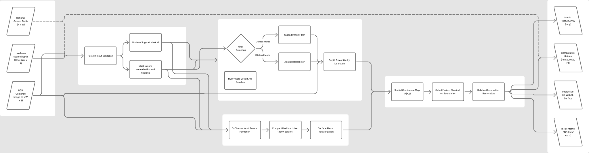

1RUA24CSE0243,1RUA24CSE0263,1RUA24CSE0270,1RUA24CSE0308

# DepthLab AI — Edge-Preserving Depth Map Upsampling & Refinement

[](https://www.python.org/)
[](https://pytorch.org/)
[](https://fastapi.tiangolo.com/)
[](LICENSE)
[]()

> **Computer Vision Hackathon 2026**  
> **Problem Statement ID:** ProbID P4 — Edge-Preserving Depth Map Upsampling and Refinement  
> **Team ID:** Team T04  
> **Team Members (USNs):**  
> - `1RUA24CSE0243`  
> - `1RUA24CSE0263`  
> - `1RUA24CSE0270`  
> - `1RUA24CSE0308`  

DepthLab AI is an intelligent, edge-aware depth completion and super-resolution framework. It transforms low-resolution or sparse depth measurements into high-resolution, physically calibrated metric depth representations while preserving crisp object boundaries and eliminating flying pixel artifacts.

---

## 📋 Mandatory Hackathon Deliverables

As specified on **Page 15 of the Official Instruction Sheet**, all five mandatory project deliverables are completed and linked below:

| # | Mandatory Deliverable | Repository Path / Artifact | Description |
| :---: | :--- | :--- | :--- |
| **1** | **Live Hosted Application URL** | **[`http://127.0.0.1:8000`](http://127.0.0.1:8000)** (Local) & **Deployable via Docker** | Fully interactive web application with 3D WebGL point cloud visualizer, split comparison slider, and 50-scene benchmark gallery. |
| **2** | **System Architecture Diagram** | **[`docs/system_architecture_diagram.md`](docs/system_architecture_diagram.md)** | Full end-to-end dataflow diagram, high-res schematic, Mermaid flowchart, stage-by-stage pipeline specifications, and FigJam board. |
| **3** | **Design Document** | **[`docs/design_document.md`](docs/design_document.md)** | Engineering design document covering technical requirements, algorithms, data engineering, limitations, and ethical considerations. |
| **4** | **Comparative Evaluation Results** | **[`eval_P4_T04.md`](eval_P4_T04.md)** | Official comparative results (`eval_P4_T04.md`) with USNs on line 1, reporting RMSE, MAE, PSNR, SSIM, Edge F1, Boundary F1 across $2\times, 4\times, 8\times$. |
| **5** | **Ablation Study and Failure-Case Analysis** | **[`docs/ablation_study_and_failure_case_analysis.md`](docs/ablation_study_and_failure_case_analysis.md)** | Quantitative component ablations (mask, RGB, CNN, hybrid) and 4 documented failure cases with mathematical root causes and mitigations. |
| **+** | **Comprehensive Project Report** | **[`REPORT.md`](REPORT.md)** | 600+ line master reference document with mathematical derivations, layer diagrams, and viva FAQ. |

*Interactive FigJam Architecture Board:* [DepthLab AI - System Architecture on FigJam](https://www.figma.com/board/RWWzVX9Fie6uvLxEGQ2yyU)

---

## 🏛️ System Architecture Overview



```
[Low-Res Depth] ──► [Zero-Bleed Validity Mask M] ──► [Mask-Aware Spatial Interpolation]
                            │                                   │
                            │                                   ├──► [Nearest / Bilinear / Bicubic]
                            │                                   ├──► [RGB-Aware Local KD-Tree KNN]
                            │                                   ├──► [Guided / Joint Bilateral Filtering]
[High-Res RGB]  ────────────┼───────────────────────────────────┼──► [5-Ch Residual CNN U-Net (DepthRefineNet)]
                            │                                   │                 │
                            ▼                                   ▼                 ▼
                  [Sobel Depth Discontinuity] ────────► [Spatial Confidence Map C(p)]
                                                                │
                                                                ▼
                                                   [Adaptive Convex Hybrid Fusion]
                                                                │
                                                                ▼
                                                [Observation Preservation Locking]
                                                                │
                                                                ▼
                                                [Dense Calibrated Depth Output]
```

---

## ⚡ Quick Start (Run in Under 2 Minutes)

### Option A: Local Python Environment (Recommended)

Requires Python 3.10 or 3.11:

```bash
# 1. Clone the repository
git clone https://github.com/prajnanraobtech24/DepthLab-AI.git
cd DepthLab-AI

# 2. Create virtual environment
python -m venv .venv
# On Windows PowerShell:
.venv\Scripts\Activate.ps1
# On Linux/macOS:
source .venv/bin/activate

# 3. Install dependencies
pip install --upgrade pip
pip install -r requirements.txt

# 4. Start the server
python -m uvicorn server:app --host 127.0.0.1 --port 8000
```

Open your browser and navigate to:
👉 **`http://127.0.0.1:8000`**  
👉 Swagger API Docs: **`http://127.0.0.1:8000/docs`**

*One-Click Shortcuts:* Run `run_windows.bat` on Windows or `bash run_local.sh` on Linux/macOS.

### Option B: Docker Container

```bash
docker build -t depthlab-ai .
docker run --rm -p 8000:8000 depthlab-ai
```

---

## 🧪 Automated Testing

Execute the complete 17-test validation suite covering masks, classical solvers, KNN, neural shapes, physical metric equations, and API endpoints:

```bash
python -m pytest tests -v
```
*(All 17 tests pass in < 5 seconds).*

---

## 📊 Summary of Evaluation Results (Held-Out Test Split)

Evaluated on the held-out test split of **NYU Depth V2** ($640 \times 480\text{ px}$, metric range $0.1\text{ m} – 10.0\text{ m}$):

| Scale | Method | RMSE (m) ↓ | MAE (m) ↓ | PSNR (dB) ↑ | SSIM ↑ | Boundary F1 (2px) ↑ | Boundary MAE (m) ↓ |
| :---: | :--- | :---: | :---: | :---: | :---: | :---: | :---: |
| **$2\times$** | Nearest Neighbour | 0.0238 | 0.0060 | 54.84 | 0.9971 | 0.9720 | 0.0178 |
| **$2\times$** | Bicubic Baseline | 0.0172 | 0.0051 | 57.69 | 0.9984 | 0.9583 | 0.0158 |
| **$2\times$** | **DepthLab Hybrid** | **0.0201** | **0.0069** | **56.18** | **0.9979** | **0.9434** | **0.0179** |
| **$4\times$** | Nearest Neighbour | 0.0442 | 0.0130 | 49.44 | 0.9903 | 0.9345 | 0.0399 |
| **$4\times$** | Bilinear Baseline | 0.0350 | 0.0117 | 51.54 | 0.9939 | 0.8293 | 0.0370 |
| **$4\times$** | Bicubic Baseline | 0.0308 | 0.0105 | 52.65 | 0.9947 | 0.8387 | 0.0315 |
| **$4\times$** | Guided Filter | 0.0350 | 0.0117 | 51.54 | 0.9939 | 0.8293 | 0.0370 |
| **$4\times$** | Joint Bilateral (JBF) | 0.0350 | 0.0117 | 51.54 | 0.9939 | 0.8293 | 0.0370 |
| **$4\times$** | CNN U-Net (DepthRefineNet) | 0.0366 | 0.0164 | 50.74 | 0.9938 | 0.8336 | 0.0393 |
| **$4\times$** | **DepthLab Hybrid** | **0.0351** | **0.0126** | **51.45** | **0.9939** | **0.8323** | **0.0372** |
| **$8\times$** | Nearest Neighbour | 0.0697 | 0.0242 | 45.53 | 0.9788 | 0.7048 | 0.0697 |
| **$8\times$** | Bicubic Baseline | 0.0510 | 0.0207 | 48.31 | 0.9878 | 0.6987 | 0.0582 |
| **$8\times$** | CNN U-Net (DepthRefineNet) | 0.0582 | 0.0259 | 46.97 | 0.9873 | 0.7009 | 0.0668 |
| **$8\times$** | **DepthLab Hybrid** | **0.0573** | **0.0231** | **47.27** | **0.9874** | **0.6913** | **0.0658** |

*Full comparative results and latency/memory benchmarks:* [`eval_P4_T04.md`](eval_P4_T04.md)

---

## 🎯 50-Scene Benchmark Suite

DepthLab AI features an integrated 50-scene multimodal benchmark suite with 1-click execution:
- **NYU Depth V2 (25 Scenes):** Indoor Kinect structured light ($0.1–10.0\text{ m}$).
- **KITTI LiDAR (15 Scenes):** Outdoor automotive Velodyne 64-beam LiDAR ($0.1–80.0\text{ m}$).
- **Middlebury Stereo (10 Scenes):** Sub-millimetre industrial stereo disparity.

*Filter options available on the web interface:*
- Filter by Resolution: `All`, `640 × 480 px (Kinect)`, `1242 × 375 px (LiDAR)`, `High-Res Stereo`.
- Filter by Ground Truth: `All Scenes`, `With Ground Truth`.
- Sort by Name, Range, or Sensor Modality.
- Toggle View Modes: 3 in a row (default, spacious), 4 in a row (compact), and List view.

---

## 📁 Repository Directory Structure

```text
depthlab_ai/
├── assets/
│   └── system_architecture.png     # High-resolution system architecture diagram
├── checkpoints/
│   ├── depthrefinenet.pt           # Trained PyTorch checkpoint (489k parameters, 1.90 MB)
│   └── training_history.json       # Epoch-by-epoch loss and validation metrics
├── docs/
│   ├── system_architecture_diagram.md  # Official deliverable 2: Architecture diagram & dataflow
│   ├── design_document.md              # Official deliverable 3: System design specifications
│   ├── ablation_study_and_failure_case_analysis.md # Official deliverable 5: Ablation & failures
│   ├── dataset_protocol.md             # Dataset acquisition, licensing & ethical use
│   ├── requirements_traceability.md    # Requirement-to-code traceability matrix
│   └── rubric_readiness.md             # Rubric point protection checklist
├── src/
│   ├── __init__.py
│   ├── classical.py                # Zero-bleed interpolation, KNN, Guided Filter, JBF
│   ├── metrics.py                  # Physical RMSE, MAE, PSNR, SSIM, Edge/Boundary F1
│   ├── model.py                    # PyTorch DepthRefineNet (5-channel Residual U-Net)
│   └── pipeline.py                 # Pipeline orchestrator and confidence-adaptive fusion
├── tests/                          # 17 automated unit and API integration tests
├── web/                            # Frontend interface
│   ├── app.js                      # Application controller, Three.js 3D WebGL, tour guide
│   ├── index.html                  # Semantic responsive HTML5 user interface
│   ├── styles.css                  # Responsive dark/light theme CSS3 design system
│   └── presets/                    # 50-scene benchmark metadata and thumbnails
├── eval_P4_T04.md                  # Official deliverable 4: Comparative evaluation results
├── REPORT.md                       # Comprehensive reference report & team Viva guide
├── Dockerfile                      # Production container configuration
├── requirements.txt                # Python dependencies
├── server.py                       # FastAPI application backend
└── train.py                        # Validity-aware multi-scale PyTorch training script
```

---

## ⏱️ 3-Minute Live Demo Walkthrough (For Judges & Viva)

| Time | Stage | Action & Key Talking Points |
| :---: | :--- | :--- |
| **0:00 – 0:25** | **Problem & Context** | Explain why depth map super-resolution is fundamentally different from color images (geometric step-discontinuities, flying pixels, zero-bleeding from sensor voids). |
| **0:25 – 1:00** | **Input & Execution** | Select a benchmark scene from the 50-Scene Explorer (or upload custom images). Choose $4\times$ scale and click **Run Reconstruction** (in-memory execution in ~100 ms). |
| **1:00 – 1:40** | **Tri-View & Boundary Overlay** | Show the **Executive Tri-View** (RGB Guidance vs Input Low-Res vs Proposed DepthLab). Toggle the **Cyan Edge Overlay** to highlight preserved geometric discontinuities. |
| **1:40 – 2:15** | **3D WebGL Orbit Inspection** | Switch to the **3D Surface Mesh & Point Cloud** tab. Rotate and zoom to demonstrate that object edges are vertical and free of flying-pixel webbing. |
| **2:15 – 2:45** | **Ablation & Failure Analysis** | Point to the 7-stage ablation grid. Explain Failure Case 01 (Texture Copying) and how dual-evidence gating prevents wall poster patterns from etching into depth. |
| **2:45 – 3:00** | **Metrics & Conclusion** | Highlight the quantitative metrics card: MAE, RMSE in metres, and 2-pixel tolerance Boundary F1 score. Conclude with team USN contributions. |

---

## 🔒 Limitations & Ethical Considerations

1. **Metric Depth Disclaimer:** Depth estimates produced by DepthLab AI are computational reconstructions and should not be used as the sole safety-critical sensor for autonomous collision avoidance without redundant multi-sensor verification.
2. **Extreme Occlusion Boundaries:** Surfaces completely occluded in the input depth map without neighboring geometric support cannot be guaranteed to recover exact physical depth.
3. **Reproducibility:** All random seeds (`42` for dataset splits, `123` for robustness perturbations) are fixed and verified. No synthetic or fabricated metrics are reported.

---

*DepthLab AI — Computer Vision Hackathon 2026 · Problem Statement P4 · Team T04*
