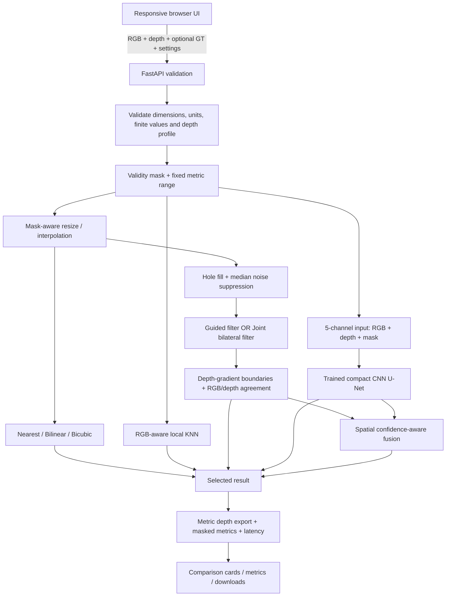

# System Architecture — DepthLab AI (P4)

## Runtime flow
1. The browser sends RGB guidance, a lower-resolution or full-resolution sparse depth map, optional ground truth, scale, unit profile and selected method.
2. FastAPI validates file size, supported formats, image dimensions, selected scale, depth units and valid depth range.
3. The pipeline detects full-resolution sparse input versus lower-resolution input (or accepts an explicit selection). It builds a boolean validity mask independently from the depth values.
4. Mask-aware interpolation prevents invalid zeros from diluting nearby valid samples. Nearest, bilinear and bicubic are separate baselines.
5. KNN uses a local spatial KD-tree with RGB colour similarity and preserves observed samples. For large point sets it deterministically subsamples support points for tractable inference; this approximation must be disclosed when it is used.
6. Classical refinement fills missing input locations, applies guided or joint-bilateral filtering, detects depth-gradient discontinuities, and preserves observed measurements. RGB edges are only supporting evidence when depth gradients also support a boundary.
7. The learned branch receives five channels (RGB, filled upsampled depth, observation mask). It runs only when a valid trained checkpoint exists.
8. Hybrid fusion uses a user-controlled base contribution for the learned branch, reduced near strong geometric boundaries in favour of the classical result. Valid full-resolution observations are restored after fusion.
9. The API returns normalized comparison previews, metric depth PNG/NPY exports and optional physical-unit metrics.

## Module responsibilities
- `server.py`: API, upload validation, depth-unit conversion, exports and metric requests.
- `src/classical.py`: masked interpolation, local RGB-aware KNN, guided/JBF, hole fill, edge/discontinuity handling.
- `src/model.py`: five-channel compact CNN U-Net.
- `src/pipeline.py`: input-type handling, method orchestration, checkpoint validation and hybrid fusion.
- `src/metrics.py`: MAE/RMSE in metres, fixed-range PSNR/SSIM, edge/boundary F1 and boundary-region errors.
- `prepare_nyu.py`: MAT inspection and conversion.
- `prepare_kitti.py`: candidate pairing manifest and opt-in NPY conversion (requires manual pairing validation).
- `evaluate_kitti.py`: separate KITTI sparse-depth/classical evaluation.
- `prepare_middlebury.py`: PFM inventory/reader; no unsupported metric conversion is performed.
- `train.py`: validity-aware synthetic-scale training.
- `evaluate.py`, `evaluate_robustness.py`: held-out comparison and controlled missing/noise experiments.

## Boundaries and known limitations
- The NYU converter creates an image-level split unless scene metadata is explicitly used; it does not claim scene-disjoint generalization.
- KITTI manifest generation is a candidate pairing aid, not a final proof of image/depth correspondence. Confirm official paths and splits before reporting.
- KITTI depth PNG values are conventionally decoded by dividing by 256 to obtain metres; zero is invalid.
- Middlebury disparity is not metric depth. Use verified scene calibration for `Z=fB/d`; otherwise keep disparity-space evaluation separate.
- The compact U-Net is trained from scratch on the selected NYU split; it is not a pretrained SOTA model.
- KNN can be slow for dense support points and uses a capped deterministic support subset above 15,000 points.
- Large holes, reflective/transparent surfaces, RGB-depth misalignment and cross-domain shift remain failure risks.
