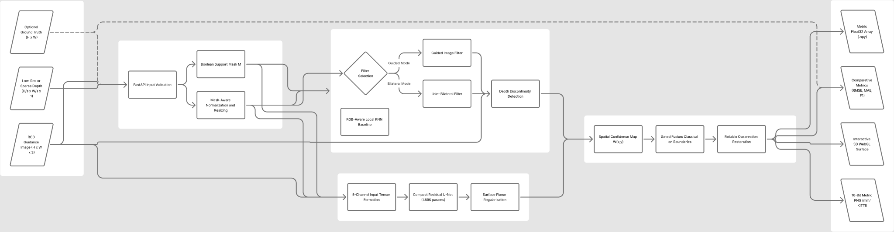
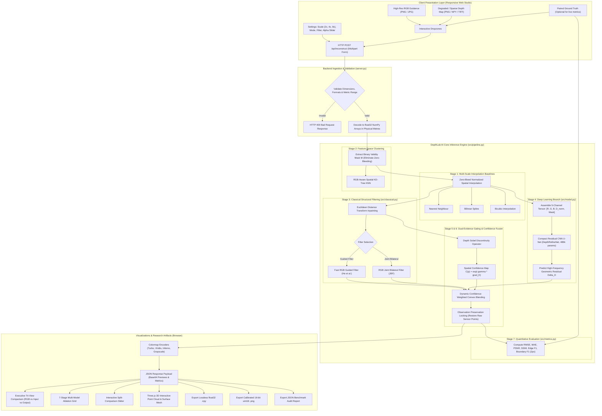

1RUA24CSE0243,1RUA24CSE0263,1RUA24CSE0270,1RUA24CSE0308

# System Architecture Diagram — DepthLab AI (P4)

**Problem Statement:** P4 — Edge-Preserving Depth Map Upsampling and Refinement  
**Team ID:** T04  
**Team USNs:** `1RUA24CSE0243`, `1RUA24CSE0263`, `1RUA24CSE0270`, `1RUA24CSE0308`  
**Interactive Architecture Diagram (FigJam):** [DepthLab AI - System Architecture on FigJam](https://www.figma.com/board/RWWzVX9Fie6uvLxEGQ2yyU)  

---

## 1. High-Resolution Architecture Diagram

---

## 2. End-to-End Pipeline Dataflow (Mermaid Specification)

---

## 3. Detailed Stage-by-Stage Architecture Walkthrough

### Stage 1: Input Ingestion & Sensor Decoupling
- **Multimodal Ingestion:** Accepts paired RGB guidance ($640 \times 480$ or arbitrary resolution) and a degraded depth map (low-resolution downsampled grid or sparse LiDAR point cloud).
- **Physical Sensor Unit Conversion:** Automatically converts raw sensor units into calibrated physical metres:
  - NYU Depth V2: millimetres $\to$ metres ($D = \text{val} / 1000.0$).
  - KITTI LiDAR: 16-bit uint16 $\to$ metres ($D = \text{val} / 256.0$).
  - Middlebury Stereo: disparity $d \to$ metric depth via $Z = \frac{f \cdot B}{d + d_{\text{offs}}}$.

### Stage 2: Zero-Bleed Boolean Validity Masking
- Constructs a strict binary indicator mask $\mathbf{M}(p) \in \{0, 1\}$.
- Prevents missing measurement pixels ($D(p) = 0$) from diluting valid physical measurements during spatial convolutions:
  $$\hat{\mathbf{D}}_{\text{interp}}(p) = \frac{\sum_{q \in \mathcal{N}(p)} w(p, q) \cdot \mathbf{M}(q) \cdot \mathbf{D}_{\text{in}}(q)}{\sum_{q \in \mathcal{N}(p)} w(p, q) \cdot \mathbf{M}(q) + \epsilon}$$

### Stage 3: Baseline Interpolation & Spatial KNN
- Computes baseline interpolations: Nearest Neighbour (0th-order), Bilinear (1st-order), and Bicubic (3rd-order spline).
- Builds a feature-space KD-Tree combining normalized pixel coordinates $(x, y)$ and RGB color $(R, G, B)$ to perform localized KNN depth propagation.

### Stage 4: Classical Structural Filtering (Guided Filter & JBF)
- Fills contiguous voids using Euclidean distance transform inpainting.
- Applies edge-preserving filters guided by the high-resolution RGB image:
  - **Fast Guided Filter:** Local linear transform $D(i) = a_k I_i + b_k$ regularized by $\lambda$.
  - **Joint Bilateral Filter (JBF):** Product of spatial Euclidean distance Gaussian and photometric range Gaussian.

### Stage 5: Deep Learning Branch (DepthRefineNet)
- **5-Channel Input:** Combines high-resolution RGB ($3$ ch), normalized interpolated depth ($1$ ch), and binary validity mask ($1$ ch).
- **Architecture:** Compact Residual CNN U-Net (489,281 parameters, 1.90 MB file size) with Group Normalization (8 groups) and LeakyReLU activations.
- **Residual Formulation:** Predicts high-frequency geometric residual $\Delta \mathbf{D}$, enforcing:
  $$\mathbf{D}_{\text{deep}} = \hat{\mathbf{D}}_{\text{interp}} + \Delta \mathbf{D}$$

### Stage 6: Dual-Evidence Gating & Confidence-Adaptive Hybrid Fusion
- Computes spatial depth confidence map $\mathbf{C}(p) = \exp\left(-\gamma \frac{\nabla_D(p)}{\max(\nabla_D) + \epsilon}\right)$.
- Combines classical and neural predictions dynamically:
  $$\mathbf{D}_{\text{hybrid}}(p) = (1 - \alpha_{\text{eff}}(p)) \cdot \mathbf{D}_{\text{classical}}(p) + \alpha_{\text{eff}}(p) \cdot \mathbf{D}_{\text{deep}}(p)$$
  - **Near sharp geometric boundaries:** $\alpha_{\text{eff}} \to 0$ (classical filter dominates, preventing neural edge blurring and flying pixels).
  - **In smooth planar regions:** $\alpha_{\text{eff}} \to \alpha_{\text{user}}$ (neural network regularizes planar surfaces).
- **Observation Preservation Locking:** For all coordinates where the physical sensor provided a valid reading, the reconstructed value is locked to the original measurement.

### Stage 7: Quantitative Evaluation & Research Studio
- Calculates physical metric depth accuracy ($\text{RMSE}$, $\text{MAE}$ in metres), perceptual fidelity ($\text{PSNR}$, $\text{SSIM}$), and geometric edge preservation ($\text{Edge F1}$, $\text{Boundary F1}_{2\text{px}}$, $\text{Boundary MAE}$).
- Streams interactive visualizations to the web client: Executive Tri-View, 7-Stage Multi-Model Ablation Grid, Split-Comparison Slider, and Three.js 3D Point Cloud.

---

## 4. Module Directory & Implementation Mapping

| Module Path | Primary Responsibility | Key Classes / Functions |
| :--- | :--- | :--- |
| [`server.py`](../server.py) | FastAPI REST server, request validation, upload decoding, export packaging | `reconstruct()`, `health_check()`, `encode_depth_png()` |
| [`src/pipeline.py`](../src/pipeline.py) | Multi-stage pipeline orchestrator, checkpoint loading, hybrid fusion | `reconstruct_depth()`, `adaptive_fusion()`, `build_validity_mask()` |
| [`src/classical.py`](../src/classical.py) | Masked interpolation, KNN KD-Tree, Guided Filter, JBF, Sobel gradients | `guided_filter()`, `joint_bilateral_filter()`, `knn_depth_completion()` |
| [`src/model.py`](../src/model.py) | PyTorch DepthRefineNet (5-channel Residual CNN U-Net) | `DepthRefineNet`, `DoubleConv`, `Down`, `Up` |
| [`src/metrics.py`](../src/metrics.py) | Physical metric equations (RMSE, MAE, PSNR, SSIM, Boundary F1) | `compute_all_metrics()`, `boundary_f1()`, `edge_f1()` |
| [`web/app.js`](../web/app.js) | Frontend interactive controller (tour, upload, slider, Three.js 3D WebGL) | `runReconstruction()`, `renderGallery()`, `initThree()` |
| [`web/styles.css`](../web/styles.css) | Responsive dark/light theme CSS3 design system (mobile/tablet/desktop) | `.sidebar`, `.gallery-grid`, `.triview-hero`, `.comparison-slider` |
| [`web/index.html`](../web/index.html) | Semantic HTML5 interface layout and accessible DOM controls | Workspace studio, gallery sub-toolbar, 3D WebGL viewport |
